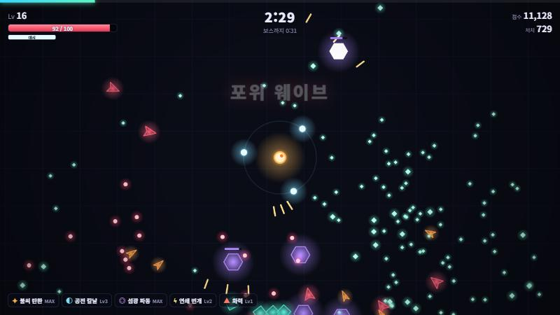

# LAST EMBER

3분을 버티고 보스를 잡는 탑다운 로그라이트 액션입니다.
**클라이언트와 서버가 같은 시뮬레이션 코드를 공유**하고, 서버가 플레이어의 입력 기록을 다시 실행해서 점수를 검증합니다. 엔진 없이 TypeScript로 직접 만들었습니다.

- 클라이언트: Canvas 2D, Web Audio (런타임 의존성 0개, 번들 gzip 약 20KB)
- 서버: Node.js 24 기본 모듈만 사용 (`node:http`, `node:sqlite`, `node:worker_threads`)
- 플레이어·적 6종·전장 배경·강화 아이콘 14종은 PNG, 점화·돌진 경고음은 WAV, 반복 배경음은 MP3를 사용하고, 나머지 전투 그래픽과 효과음은 코드로 생성

**바로 플레이: https://esin3329.github.io/last-ember/** · 미러: https://last-ember-bib.pages.dev (정적 호스팅이라 오프라인 모드로 동작합니다. 리더보드와 서버 검증은 로컬에서 서버를 띄워야 볼 수 있습니다.)



## 실행

Node.js 24 이상이 필요합니다.

```bash
npm install
```

```bash
npm run dev
```

브라우저에서 http://localhost:5173 을 엽니다. API 서버는 8787 포트에 함께 뜹니다.

| 명령 | 설명 |
| --- | --- |
| `npm run dev` | API 서버 + Vite 개발 서버 |
| `npm test` | 시뮬레이션·게임 규칙 단위 테스트 + API 통합 테스트 |
| `npm run build` 후 `npm start` | 클라이언트를 빌드해 서버 하나로 서빙 (8787) |
| `npm run balance -- 30` | 봇으로 30판을 헤드리스로 돌려 난이도·성능 측정 |
| `npm run verify:csharp` | C# 코어가 TypeScript와 같은 결과를 내는지 대조 (.NET SDK 필요) |

### 서버 환경 변수

| 변수 | 기본값 | 설명 |
| --- | --- | --- |
| `PORT` | `8787` | HTTP 포트 |
| `DB_PATH` | `data/runs.db` | SQLite 파일 경로 (`:memory:`로 메모리 DB 사용) |
| `VERIFY_WORKERS` | 자동 (`1`–`4`) | 검증 워커 수 |
| `TRUST_PROXY` | `0` | 신뢰할 프록시 홉 수. `0`은 `X-Forwarded-For`를 무시합니다. `1`은 오른쪽 첫 주소, `2`는 오른쪽 두 번째 주소를 사용합니다. 서버가 해당 홉 수의 신뢰 프록시 뒤에 있을 때만 설정하세요. |

조작: `WASD` 이동 (공격은 자동), `Space` 대시, `1` `2` `3` 강화 선택, `Esc` 일시정지, `M` 음소거, `F3` 성능 정보

터치 기기에서는 화면을 끌어 이동하고 대시 버튼으로 회피합니다. 세로 화면에서도 HUD와 강화 카드가 맞게 배치됩니다.

## 게임 설계

한 판은 약 3~5분입니다. 3분 동안 점점 거세지는 적을 버티며 빌드를 만들고, 3분에 나오는 보스를 잡으면 승리합니다.
설계 목표는 **"매 순간 선택할 거리가 있는 것"** 이었고, 그래서 아래 다섯 가지를 넣었습니다. 수치는 전부 [shared/defs.ts](shared/defs.ts) 한 곳에 있습니다.

| 요소 | 규칙 | 노린 효과 |
| --- | --- | --- |
| **무기 진화** | 무기 MAX + 짝 패시브 Lv2 → 레벨업 맨 앞에 진화 카드 (불씨 탄환+화력 → 태양창, 공전 칼날+신속 → 폭풍 고리, 섬광 파동+생명력 → 생명 파동, 연쇄 번개+가속 → 뇌신) | 일반 무기 카드에 진화 조건을 적어 두어, 레벨업마다 "지금 강해지기" vs "진화를 향해 가기"를 고르게 한다 |
| **엘리트와 보물 상자** | 보스 전까지 45초마다 금테 엘리트 등장. 처치하면 상자를 떨구는데, 자석에 끌려오지 않아 직접 주우러 가야 한다 | 도망만 다니는 플레이를 깨고, 위험을 감수하면 추가 강화 1회를 준다 |
| **자폭병** | 가까이 오면 멈춰서 도화선을 태우고(범위 표시) 폭발한다. 놓치면 큰 피해, **먼저 잡으면 그 폭발이 주변 적만 휩쓴다** | 같은 적이 위협이자 무기가 된다. 적 무리 한가운데 자폭병을 노리는 판단이 생긴다 |
| **보스 2페이즈** | 체력 50% 이하에서 조준(예고선) → 조준 고정 → 돌진 패턴 추가 | 탄막 회피에 "언제 대시를 아껴 둘지" 판단을 더한다 |
| **무피격 콤보** | 피격 없이 40킬마다 점수 배율 +0.5 (최대 ×3). 맞으면 초기화 | 생존만이 아니라 깔끔한 플레이가 리더보드 순위를 가른다 |

밸런스는 봇 40판을 헤드리스로 돌려 맞췄습니다(`npm run balance`). 처음 넣었을 때 수치를 재 보니 두 가지가 크게 어긋나 있었습니다.

- **태양창이 보스를 10~20초 만에 녹였습니다.** 관통 탄환이 보스 주변 소환수를 맞힐 때마다 폭발이 생기고, 그 폭발이 전부 보스까지 맞혔기 때문입니다. 보스는 폭발 피해를 25%만 받게 했습니다.
- **엘리트가 사망 원인 1위였습니다.** 엘리트 체력·피해를 바꿔 가며 비교하니 체력보다 접촉 피해가 문제였습니다. 체력 배율 9 → 4, 피해 배율 1.3 → 1로 낮췄습니다.

이 조정 뒤 보스전 시간은 23~79초, 보스 도달률은 60%, 승률은 40%입니다(봇 기준). 사람이 직접 플레이하며 맞춘 난이도는 아니라서, 실제 체감은 플레이 피드백으로 다시 조정해야 합니다.

새 규칙은 [shared/test/design.test.ts](shared/test/design.test.ts)에서 상태를 직접 꾸며 검증합니다. 예를 들어 "먼저 잡은 자폭병은 주변 적 2마리를 날리고 플레이어는 다치지 않는다", "보스는 예고 시간 동안 멈춰 있다가 고정된 방향으로 돌진한다" 같은 것들입니다.

## 무엇을 보여주려 했나

### 1. 결정론적 시뮬레이션 — [shared/sim.ts](shared/sim.ts)

같은 시드와 같은 입력이면 브라우저와 Node에서 체크섬까지 같은 결과가 나옵니다. 이를 위해 지킨 규칙입니다.

- **고정 타임스텝 60Hz.** 시뮬레이션에는 실제 프레임 시간이 들어가지 않습니다. 화면은 이전 틱과 현재 틱 사이를 보간해서 그립니다.
- **시드 RNG만 사용** (mulberry32, 정수 연산).
- **부동소수 연산은 `+ - * / sqrt`만 사용.** `sin`/`cos`/`atan2`는 엔진마다 마지막 비트가 다를 수 있어서 시뮬레이션에서 쓰지 않습니다. 회전은 상수 회전 행렬로, 무작위 방향은 기각 샘플링으로 만듭니다.
- **순회 순서 고정.** 엔티티 배열과 그리드 삽입 순서가 항상 같습니다.
- **폭발은 큐로 처리.** 자폭병 폭발이 다른 자폭병을 터뜨리는 연쇄를 즉시 처리하면, 순회 중인 배열이 바뀌고 처리 순서가 호출 깊이에 따라 달라집니다. 폭발을 큐에 쌓았다가 무기·탄환 처리 뒤에 순서대로 풉니다.
- **연출과 로직 분리.** 시뮬레이션은 이벤트만 내보내고, 파티클·화면 흔들림·효과음은 클라이언트가 그 이벤트로 만듭니다. 서버는 이벤트 생성 자체를 끕니다.

### 2. 서버 권위 점수 검증 — [server/src/app.ts](server/src/app.ts)

클라이언트가 보낸 점수를 믿지 않습니다.

1. 서버가 시드를 발급해 클라이언트에 공개합니다. 서버 발급으로 임의 시드 선택을 줄이지만, 공개된 시드의 오프라인 최적화 자체를 막지는 못합니다. 한 IP에서 열린 판은 최대 3개이며, 새 판이 상한을 넘으면 가장 오래된 미제출 판을 무효화합니다.
2. 클라이언트는 매 틱의 입력을 1바이트로 인코딩하고 RLE로 압축해 기록합니다 ([shared/input.ts](shared/input.ts)). 3~4분짜리 판이 약 18KB입니다.
3. 판이 끝나면 입력 기록을 제출하고, 서버가 같은 시뮬레이션을 재실행합니다. 재실행 결과의 점수와 체크섬이 일치할 때만 리더보드에 올립니다.
4. 검증된 판은 누구나 리더보드에서 리플레이로 다시 볼 수 있습니다. 영상이 아니라 입력 기록을 재생하는 것입니다.

함께 넣은 방어 장치입니다.

| 공격 | 대응 |
| --- | --- |
| 점수 값 조작 | 서버 재실행 결과와 불일치 → `422 mismatch` |
| 배속 제출·오프라인 최적화 | 제출 최소 경과 시간 검사 (`422 too_fast`), IP당 열린 시드 3개 제한 및 발급 20분 후 만료 (`422 expired`). 시드를 받은 뒤 입력을 최적화하고 최소 경과 시간까지 기다리는 공격은 완전히 막지 못함 |
| 같은 판 중복 제출 | 상태 조건을 건 `UPDATE`로 원자적 선점 → `409` |
| 서버 중단 중 검증 중이던 판 | 시작 시 `rejected(interrupted)`로 회수하고, 오래된 `verifying` 판도 주기 정리에서 회수 |
| 검증 요청 폭주 | IP별 토큰 버킷 + 검증 대기열 상한 (`429`, `503`) |
| 거대한 요청 본문, 잘못된 입력 코드 | 재실행 전에 크기·형식 검증 (`413`, `400`) |
| 이름을 통한 스크립트 삽입 | 서버에서 제어 문자 제거, 클라이언트는 `textContent`로만 출력 |

### 3. 메인 스레드를 막지 않는 검증 — [server/src/verifier.ts](server/src/verifier.ts)

한 판 재실행에 평균 약 130ms의 CPU가 듭니다 (측정값, 아래 표). 메인 스레드에서 돌리면 그동안 모든 요청이 멈추므로 워커 스레드 풀로 넘깁니다. 작업별 기본 타임아웃은 10초이며, 워커의 `error`·`exit`·시간 초과 때 맡은 작업을 실패시키고 워커를 교체합니다. 해당 요청은 `503 verify_error`로 반환합니다.

### 4. 성능을 고려한 구조

- **공간 분할 그리드** — 적 충돌·분리·범위 공격 판정을 균일 그리드로 처리합니다. `Int32Array` 연결 리스트 방식이라 매 틱 할당이 없습니다.
- **오브젝트 풀** — 파티클 700개를 미리 만들어 재사용합니다.
- **배치 렌더링** — 적을 종류별로 한 경로에 모아 한 번에 그리고, 화면 밖 개체는 건너뜁니다.
- **HUD는 값이 바뀔 때만 DOM 갱신.**

### 5. 테스트 가능한 설계

- 서버는 저장소·검증기·시계를 주입받습니다. 통합 테스트는 메모리 DB와 가짜 시계로 "3분짜리 판을 3초 만에 제출" 같은 상황을 즉시 재현합니다 ([server/test/api.test.ts](server/test/api.test.ts)).
- 자동 플레이 봇([shared/bot.ts](shared/bot.ts))을 테스트 입력 생성, 밸런스 측정, 메뉴 배경 데모에 함께 씁니다.

## 측정값

개발 PC(Node 24.15)에서 `npm run balance`와 리플레이 재실행으로 잰 값입니다.

| 항목 | 값 |
| --- | --- |
| 시뮬레이션 1틱 | 평균 약 12µs (60Hz 예산 16.6ms의 0.1%) |
| 최대 동시 적 | 291 |
| 한 판 서버 검증 | 평균 약 130ms (평균 11,000틱) |
| 리플레이 크기 | 평균 약 18KB (JSON) |
| 봇 40판 | 보스 도달 24, 승리 16, 진화 판당 0.57회 |

## 구조

```
shared/   클라이언트·서버 공용. DOM/Node API를 쓰지 않는 순수 로직
  sim.ts      시뮬레이션 코어 (step 함수 하나로 한 틱 진행)
  defs.ts     적·무기·강화·진화 수치 테이블
  input.ts    입력 인코딩, RLE 기록/복원/검증
  rng.ts      시드 RNG
  replay.ts   입력 기록 재실행
  bot.ts      자동 플레이 봇
  test/       결정론·입력 인코딩·게임 규칙 테스트
client/   렌더링, 이펙트, 사운드, UI, 키보드·터치 입력, 메인 루프
server/   HTTP API, SQLite 저장소, 검증 워커 풀, 속도 제한
csharp/   시뮬레이션 코어의 C# 포팅(Unity용)과 교차 검증 도구
scripts/  개발 서버 실행, 밸런스 측정, C# 검증용 기준 데이터 생성
```

## 알고 있는 한계

- **시드를 받은 뒤 오프라인에서 입력을 최적화하는 것은 막지 못합니다.** 최소 플레이 시간 검사, IP당 열린 시드 3개 제한, 발급 후 20분 만료로 공격 기회만 줄입니다. 만료 전 최적 입력을 계산한 뒤 제출 최소 시간까지 기다리는 방식은 여전히 가능합니다. 시드 구간별 공개 등 프로토콜 변경 없이는 완전 차단할 수 없습니다.
- **사람 대신 봇이 실시간으로 플레이하는 것도 막지 못합니다.** 리플레이 검증은 "이 입력으로 이 점수가 나온다"만 보증합니다. 입력 패턴 분석이 다음 단계입니다.
- 서버는 단일 프로세스 + SQLite입니다. 수평 확장하려면 속도 제한과 저장소를 외부(Redis, PostgreSQL)로 옮겨야 합니다.
- 터치 조작은 화면 크기 에뮬레이션으로만 확인했고 실제 기기에서는 시험하지 못했습니다. 게임패드 입력은 없습니다.
- 수치를 바꾸면 기존 리플레이가 깨집니다. `SIM_VERSION`으로 구분해 리더보드를 분리합니다.

## C# 코어 (Unity용) — [csharp/LastEmber.Core](csharp/LastEmber.Core)

시뮬레이션 코어를 C#으로 포팅했습니다. `UnityEngine`을 참조하지 않는 순수 C#(.NET Standard 2.1, C# 9)이고 asmdef를 포함하고 있어, 폴더를 Unity 프로젝트의 `Assets`에 넣으면 어셈블리로 잡히도록 구성했습니다.

**TypeScript 버전과 결과가 같습니다.** `npm run verify:csharp`는 TS 봇이 플레이한 10판(승리 6, 사망 4, 총 120,314틱, 진화 4종·엘리트·자폭병 연쇄·보스 돌진이 모두 나오도록 시드를 고름)의 입력 기록을 C#으로 재실행해서 점수·처치 수·틱 수·체크섬을 비교합니다. 전부 일치합니다. 따라서 C# 클라이언트가 만든 입력 기록도 이 저장소의 Node 서버가 그대로 검증할 수 있습니다.

포팅하면서 맞춘 것들입니다.

- JS의 `number`는 배정밀도라 C#도 `double`만 사용하고, 식의 계산 순서를 그대로 유지했습니다.
- `Math.imul`, `| 0`, `>>>` 같은 32비트 정수 연산은 `unchecked` int/uint 연산으로 옮겼습니다.
- 난수 호출 순서와 엔티티 순회 순서를 동일하게 두었습니다.

Unity에서 쓸 때는 `Sim.Step()`을 자체 누적기에서 1/60초마다 호출하고, `Sim.Events`를 읽어 파티클·사운드를 재생하는 `MonoBehaviour`가 렌더러 역할을 맡으면 됩니다.

확인하지 못한 부분입니다. 일치 여부는 .NET 10(x64)에서 확인했고, Unity 에디터에서 불러오거나 빌드해 보지는 않았습니다. IL2CPP나 ARM 빌드는 C++ 컴파일러가 곱셈·덧셈을 FMA로 합치면 마지막 비트가 달라질 수 있어서, 그 환경에서는 같은 검증을 다시 돌려 봐야 합니다.
